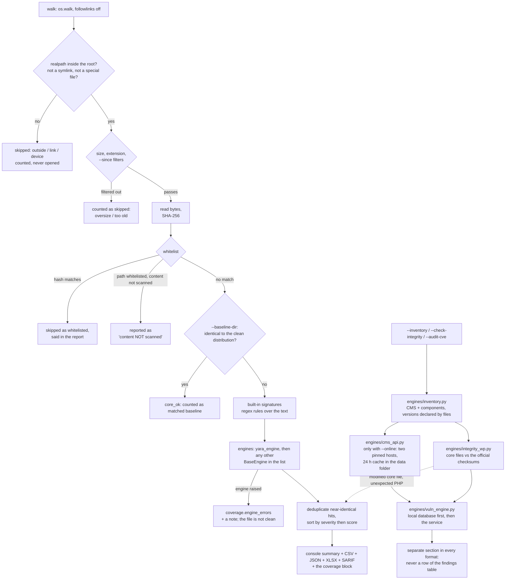

# Architecture

For users: `README.md` (and `docs/README_RU.md`). This file is for the person who has
to change the code or explain why it behaves the way it does.

## Pieces

| Path | What it is | Runs on |
|---|---|---|
| `src/scan_backdoors.py` | the scanner: walk, read, score, report | any shell |
| `src/scan_backdoors_gui.py` | a local HTTP server + one HTML page; it starts the scanner as a child process | a workstation |
| `src/clean_malware.py` | mass cleanup: quarantine, restore from manifest, replace modified core files | a shell, after the scan |
| `src/joomla_baseline.py` | fetches a clean Joomla distribution for `--baseline-dir` | the operator's machine, on request |
| `src/updater.py` | installs and activates rule packages atomically, with rollback and signature policy | the operator's machine, on request |
| `src/version.py` | the bundle version and `MIN_SCANNER`, written once | - |
| `engines/` | the pluggable detection side: `base_engine` (the interface and the constants the scanner must agree with), `yara_engine`, `yara_check` (the rule linter), and the Sprint 3 audit engines `versions`, `inventory`, `cms_api`, `integrity_wp`, `vuln_engine` | in-process, and `yara_check` as a subprocess |
| `tools/` | development-only helpers (`build_allowlist`, `fp_measure`, `record_golden`, `coverage_run`) | a checkout |
| `benchmarks/` | `bench_scan.py` and its reference records | a checkout |
| `tests/` | 500-odd unittest cases; `harness.py` and `fixtures_sites.py` are the shared fixtures | a checkout |

Nothing in `src/` or `engines/` imports a third-party module at module level; the two
optional ones (`yara`, `cryptography`) are imported inside the one function that needs
them. `tests/test_compat.py` enforces both the import list and the Python 3.6 grammar.

## The scan pipeline

What §4.3 of the technical specification describes, as the code actually does it:



Two properties are structural rather than incidental:

* **A skip is never silent.** Every file that was not scanned lands in a counter that
  the report prints (`skipped: oversize / too old / unreadable / engine errors`), and
  an engine exception is a *coverage* problem, not a clean result.
* **Findings and vulnerability verdicts are different kinds of thing.** A finding
  points at bytes on disk and can be quarantined; a verdict points at a *version* and
  is treated by updating the component. The pipeline keeps them in separate sections of
  every output format, and only findings can change the exit code (a CVE changes it
  only when `--fail-on` was asked for - then with code `4`).

## Trust boundaries

Everything the tools read from a scanned site is **hostile input**: file contents,
`readme.html`, plugin headers, extension manifests, the CMS version string, a rule
package's own metadata. Consequences you can find in the code:

* manifests are parsed with a parser that refuses `DOCTYPE`/`ENTITY`, under a size cap,
  and no site PHP is ever executed to learn a version;
* `include` is refused when compiling YARA rules, and every rule file compiles alone;
* a rule package is only activated after it is extracted into a staging folder with
  path checks, compile-checked, and (when a key is pinned) signature-checked; a wrong
  signature is a refusal, never a downgrade;
* the scanner never writes into a scanned tree (`tests/test_golden_scan.py` compares
  the tree's hashes before and after a scan, and `tests/test_pipeline_core.py` does the
  same for `--self-test`);
* outbound network calls exist in exactly two places (`joomla_baseline.py`,
  `cms_api.py`), each behind an explicit user action, each to an allowlisted host, each
  re-checking the URL after every redirect, each with a size cap and a cache. The
  scanner's default run makes no request at all - `tests/test_audit_cli.py` proves it
  by replacing `socket.socket` with a trap.

Where state lives: everything the tools keep between runs is in **one data folder**
(`$SBD_DATA_DIR`, else `~/.scan_backdoors`): the rule releases and `sources.json`, the
`.yarac` cache, the Joomla baseline cache, the GUI whitelist, the audit cache and the
audit's local vulnerability database. `tests/test_data_paths.py` pins that.

## Processes and parallelism

The scanner parallelises with `multiprocessing` (`--workers`, `0` = auto, `1` = no
parallelism). On Windows `spawn` is the only start method, so a worker is a fresh
interpreter: the configuration is passed as a plain dict, engines are built **once per
worker** (`--yara-rules` compiles, or loads the `.yarac` cache, in the worker, not per
file), and nothing is inherited from the parent's memory. The GUI, in turn, starts the
scanner as a child process and reads its `@@`-prefixed progress lines - which is why
`tests/test_gui*.py` run a real GUI subprocess instead of importing the module.

## Coverage

```bash
python -m pip install -r requirements-dev.txt
python tools/coverage_run.py                        # suite + report
python tools/coverage_run.py --require 70 --core engines --core src/scan_backdoors.py
```

Use the tool, not `python -m coverage run -m unittest discover`. The latter is the usual
recipe and it produces a confident wrong answer here, in two independent ways:

* **The tests are a family of processes.** The suite launches the CLI, the GUI, the
  cleaner and the updater the way a user does, so the parent process is a small part of
  what runs. A child starts coverage only if coverage is imported before anything else
  in it, which is what `coverage.process_startup()` plus a `sitecustomize.py` on
  `PYTHONPATH` do - that is the whole trick, and the tool sets it up and tears it down.
* **`source` is relative to the CWD of the process that reads the configuration**, and
  the harness launches the tools with `cwd=src/`. A child given `source = src` looks for
  `<repo>/src/src`, finds nothing and records nothing. So the tool writes a temporary
  configuration with absolute paths. The symptom of this bug is specific and worth
  knowing: `src/clean_malware.py` and `src/scan_backdoors_gui.py` read exactly 0 % while
  their end-to-end tests pass.

Both effects together, on the same tests: 43.9 % measured in the parent alone, 77.3 % for
the family. The numbers below are the family numbers (branch coverage, 2026-11-28,
Python 3.11 with `yara-python` installed; they move by a point or two between runs, which
is what a suite partly driven by subprocesses and watched by antivirus does):

| Module | | Module | |
|---|---|---|---|
| `engines/cms_api.py` | 95.3 % | `src/updater.py` | 84.6 % |
| `engines/versions.py` | 94.7 % | `src/joomla_baseline.py` | 77.0 % |
| `engines/integrity_wp.py` | 92.3 % | `src/scan_backdoors.py` | 80.4 % |
| `engines/vuln_engine.py` | 92.5 % | `src/clean_malware.py` | 71.9 % |
| `engines/base_engine.py` | 90.9 % | `src/scan_backdoors_gui.py` | 65.4 % |
| `engines/yara_check.py` | 96.8 % | `engines/*` as a whole | 90.8 % |
| `engines/inventory.py` | 84.2 % | **TOTAL** | **77.3 %** |

* `branch = True`, because in this code the interesting behaviour is usually the branch
  that was *not* taken (a refused URL, an unreadable version, a corrupt cache entry).
* The CI gate is per module, not an average: TZ §9.1 asks for the **pipeline core**, so
  `engines/` and `src/scan_backdoors.py` each have to reach 70 %, and the total has to as
  well. `src/scan_backdoors_gui.py` sits below it and is not gated: the harness drives the
  GUI as a subprocess with a private data folder, and what is missing from that number is
  the page plumbing reached only by a browser clicking, not a branch nobody tested.
  Read a low GUI number as "not line-verified", not as "not tested":
  `tests/test_gui*.py` assert what the page shows and what the buttons do.
* The measurement writes nothing into the repository: the data files go to a temporary
  directory, and the tool refuses a `--data-dir` inside the fixtures root or the checkout,
  because a stray `.coverage.<host>.<pid>` file is then *scanned* as a file of the site
  under test.


## Lint and static checks

`ruff.toml` is the whole story for `ruff check src engines tests tools benchmarks`, and
the CI job adds `bandit` over `src engines tools` with an explicit list of skipped
tests. Both ignore lists say *why* - the 3.6 floor forbids some idioms, some findings
describe the project's deliberate design (md5 as wordpress.org's catalogue key,
ElementTree on manifests that already had `DOCTYPE` refused, launching `xdg-open`). A
new rule family is added only after reading every finding it produces.

## Benchmarks

`benchmarks/bench_scan.py` scans the same generated tree twice - once without the rule
package, once with it, cold and warm for the `.yarac` cache - and reports the ratio
against the +30 % budget, files/second, and the peak memory of the whole process tree
sampled from outside the child (`/proc` on Linux, `psapi` on Windows, `null` and an
explanation elsewhere). Reference records live in `benchmarks/reference/`; a record from
a different machine is a comparison across machines, and the JSON says which machine it
came from.

## CI

`.github/workflows/ci.yml` has five jobs:

* **tests** - the whole suite on Linux and Windows, Python 3.11 and 3.13, each once with
  `yara-python` installed and once with nothing installed. The second leg is not a
  formality: it is the only place where "the scanner needs no dependencies" is executed
  rather than asserted in a docstring. A step prints which of the two it is, because a
  suite that skipped every YARA case looks exactly like a suite that passed them.
* **floor** - the same suite inside `python:3.6-slim` and `python:3.8-slim`, images pinned
  by *digest*, driven with `docker run` (the images have no git, so the checkout happens on
  the runner and is mounted in). An old interpreter cannot be emulated by a newer one, and
  3.6 is no longer in a runner's tool cache. Nothing is pip-installed there:
  `requirements-dev.txt` needs 3.11+, and `yara-python` 4.5.4 ships wheels for cp39-cp313,
  so the optional engine is not part of the floor story and cannot be.
* **quality** - `ruff`, `bandit`, and `tools/coverage_run.py --require 70` with the two core
  gates. This leg installs the optional engine: a percentage for `engines/yara_engine.py`
  measured where its tests skipped would say nothing about it.
* **self-scan** - the scanner over this repository. The gate is over the code; the whole
  tree is scanned a second time into the artifact, because our own changelog quotes the
  markers the scanner hunts for and that is a report, not a failure.
* **benchmark** - a small `bench_scan.py` run: the harness working, not a timing authority.

Actions are pinned to commit SHAs with the version in a comment; re-read them with
`git ls-remote --tags <repo> 'refs/tags/vN^{}'` rather than trusting a blog post, since an
*annotated* tag's own SHA is a tag object and not the commit. Images are pinned by digest
(`docker manifest inspect`, or the registry's `Docker-Content-Digest` header - Docker Hub's
REST API does not report one). The workflow asks for `contents: read`, uses no secret, and
has no `schedule:` trigger: a scheduled workflow runs from the default branch only and is
disabled automatically in a public repository after 60 days without activity, so it is a
decision for the owner, not a default - see `docs/OPEN_QUESTIONS.md` (#17, #18, #19).
